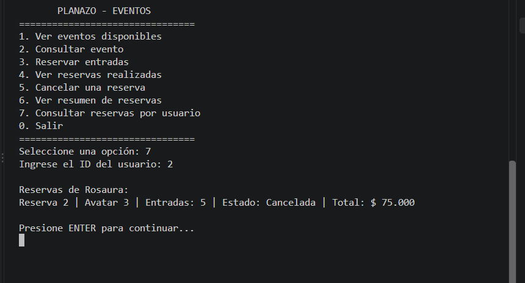
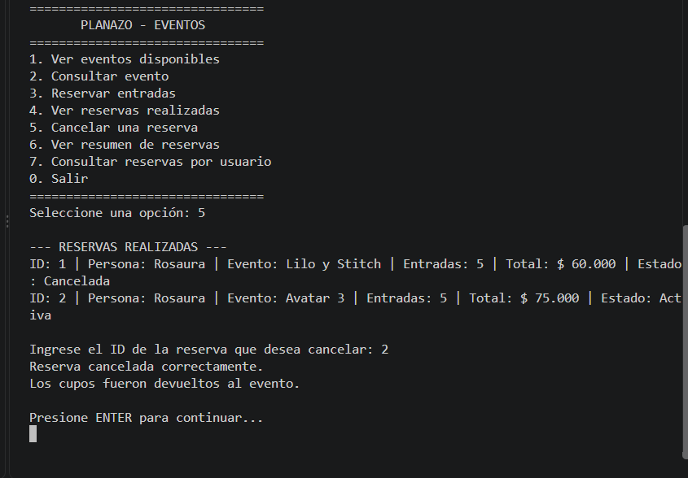
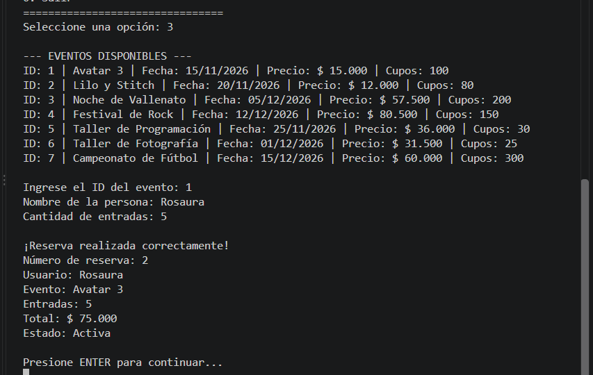
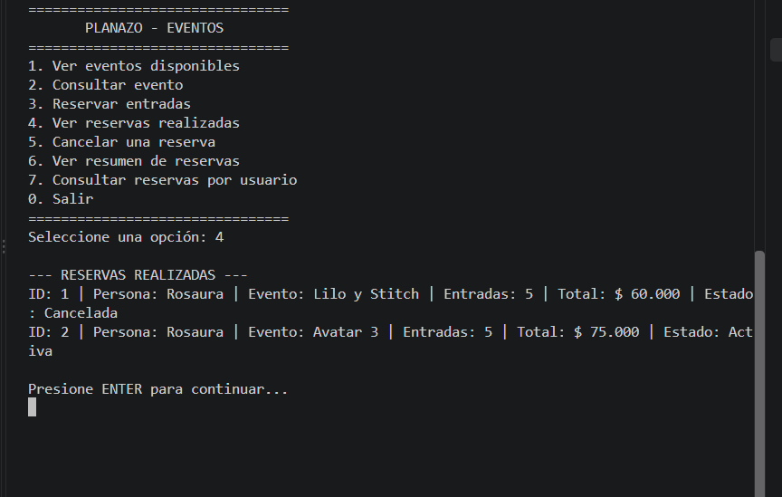
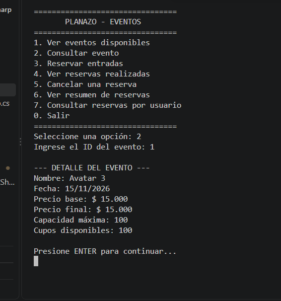
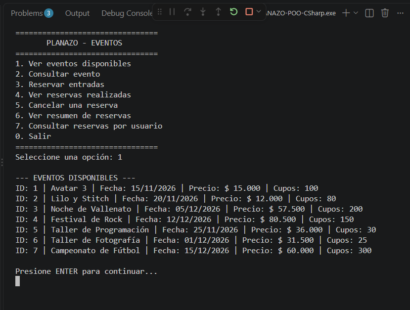

# PLANAZO - Sistema de Gestión de Eventos y Reservas

## 1. Descripción del proyecto

PLANAZO es una aplicación de consola desarrollada en C# que permite gestionar eventos y reservas de entradas. El sistema ofrece opciones para consultar eventos, reservar entradas, visualizar las reservas realizadas, cancelar reservas, consultar un resumen de las reservas activas y buscar las reservas asociadas a un usuario.

La aplicación permite trabajar con diferentes tipos de eventos, como películas, conciertos, talleres y eventos deportivos. Cada tipo de evento tiene sus propias reglas para calcular el precio final.

Este proyecto se desarrolla como parte de una actividad académica de Programación Orientada a Objetos (POO), aplicando los conceptos estudiados durante el curso.

## 2. Objetivo general

Desarrollar una aplicación de consola en C# para gestionar eventos y reservas de entradas, aplicando los principios de la Programación Orientada a Objetos y permitiendo controlar la disponibilidad de cupos y el estado de las reservas.

## 3. Tipos de eventos

El sistema permite gestionar los siguientes tipos de eventos:

- **Cine:** conserva el precio base del evento.
- **Concierto:** aplica un incremento del 15 % sobre el precio base.
- **Taller:** aplica un descuento del 10 % sobre el precio base.
- **Evento deportivo:** aplica un incremento del 20 % sobre el precio base.

Cada tipo de evento calcula su precio final de acuerdo con las reglas establecidas en el programa.

## 4. Funcionalidades principales

La aplicación cuenta con las siguientes opciones:

1. **Ver eventos disponibles:** muestra los eventos registrados, sus fechas, precios y cupos disponibles.
2. **Consultar un evento:** permite buscar un evento por su identificador y consultar sus detalles.
3. **Reservar entradas:** registra una reserva, calcula el valor total y actualiza la disponibilidad de cupos.
4. **Ver reservas realizadas:** muestra el historial de reservas y sus estados.
5. **Cancelar una reserva:** permite cancelar una reserva activa y devolver los cupos al evento.
6. **Ver resumen de reservas:** presenta información general de las reservas activas.
7. **Consultar reservas por usuario:** permite consultar las reservas asociadas a un usuario específico.
8. **Salir:** finaliza la ejecución del programa mediante la opción 0.

## 5. Conceptos de Programación Orientada a Objetos aplicados

Durante el desarrollo de PLANAZO se aplican los siguientes conceptos:

- **Clases y objetos:** representan los eventos, los usuarios y las reservas.
- **Abstracción:** permite definir características y comportamientos comunes mediante la clase abstracta `Evento`.
- **Herencia:** permite crear tipos específicos de eventos a partir de una clase base.
- **Polimorfismo:** permite que cada tipo de evento implemente su propia forma de calcular el precio final.
- **Encapsulamiento:** ayuda a organizar y controlar el acceso a los datos y comportamientos de las clases.
- **Métodos:** permiten ejecutar operaciones como consultar eventos, crear reservas, cancelar reservas y calcular precios.

## 6. Tecnologías utilizadas

- **Lenguaje de programación:** C#.
- **Plataforma:** .NET.
- **Editor de código:** Visual Studio Code.
- **Control de versiones:** Git.
- **Repositorio remoto:** GitHub.

## 7. Estructura del proyecto

La estructura principal del proyecto está organizada de la siguiente manera:

```text
PLANAZO-POO-CSharp/
├── Capturas/
├── Modelos/
├── Servicios/
├── Program.cs
├── README.md
└── PLANAZO-POO-CSharp.csproj
```

Descripción de los elementos principales:

- **Capturas:** contiene las imágenes de las pruebas realizadas durante la ejecución del programa.
- **Modelos:** contiene las clases que representan los eventos, usuarios y reservas.
- **Servicios:** contiene la lógica para gestionar las reservas y las operaciones del sistema.
- **Program.cs:** contiene el menú principal y el punto de entrada de la aplicación.
- **README.md:** contiene la documentación del proyecto.

Los directorios `bin` y `obj` son generados automáticamente durante la compilación y ejecución del proyecto.

## 8. Requisitos para ejecutar el proyecto

Para ejecutar PLANAZO se requiere:

- Tener instalado el SDK de .NET.
- Disponer de los archivos del proyecto.
- Abrir una terminal en la carpeta principal del proyecto.

## 9. Instrucciones de ejecución

1. Abrir la carpeta `PLANAZO-POO-CSharp` en Visual Studio Code.
2. Abrir una terminal integrada desde el menú **Terminal**.
3. Verificar que la terminal esté ubicada en la carpeta principal del proyecto.
4. Ejecutar el siguiente comando:

```bash
dotnet run
```

5. Esperar a que aparezca el menú principal y seleccionar la opción deseada.

## 10. Evidencias de funcionamiento

##  Consulta de reservas por usuario

Función: Permite buscar las reservas de un usuario mediante su identificador, mostrando los eventos reservados y la cantidad de entradas asociadas.


## Cancelación de una reserva
Función: Permite cancelar una reserva existente, cambiar su estado a cancelada y devolver los cupos al evento correspondiente.


## Registro de una reserva
Función: Permite seleccionar un evento, registrar el usuario y la cantidad de entradas que desea reservar, calcular el valor total y guardar la reserva.


## Consulta de reservas realizadas
Función: Permite visualizar las reservas registradas en el sistema, mostrando la información de cada reserva y su estado, ya sea activa o cancelada.


## Consulta de un evento
Función: Permite consultar los detalles de un evento específico mediante su identificador, incluyendo su nombre, fecha y precio de la entrada.


## Consulta de eventos disponibles
Función: Permite visualizar el listado de eventos disponibles, mostrando información como sus nombres, fechas, precios y cantidad de cupos disponibles.



## 11. Autoría

**Autora:** Rosaura León

**Nombre del proyecto:** PLANAZO - Sistema de Gestión de Eventos y Reservas.

**Área:** Electiva de profundización.

**Lenguaje de programación:** C#.

## 12. Conclusión

El desarrollo de PLANAZO permitió aplicar los conceptos de Programación Orientada a Objetos en una aplicación práctica para gestionar eventos y reservas. Mediante sus funcionalidades es posible consultar eventos, calcular precios, registrar reservas, controlar los cupos disponibles y cancelar entradas.

Además, la organización del código en modelos y servicios facilita la comprensión del funcionamiento de la aplicación. Las capturas de pantalla incluidas en este documento sirven como evidencia de las pruebas realizadas y del funcionamiento de las opciones principales del sistema.